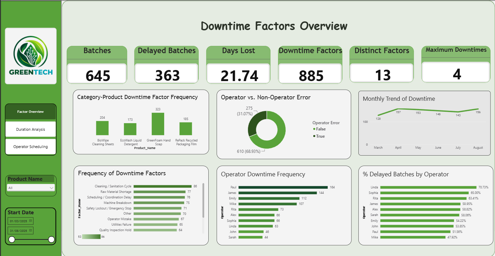
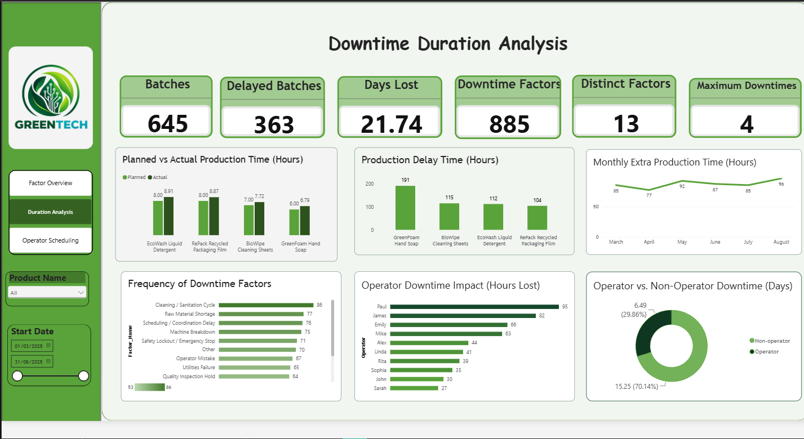
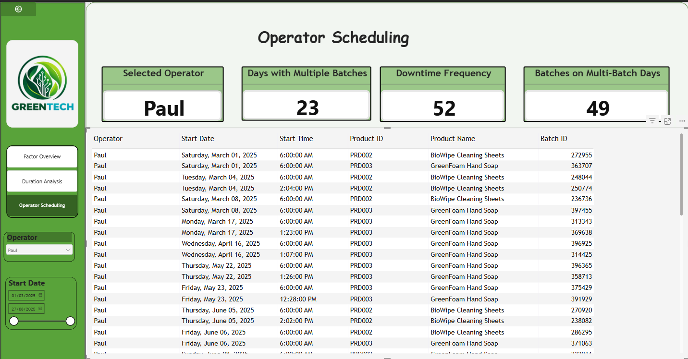

# Evaluating Production Bottlenecks Through Downtime Analysis

**Tools:** SQL Server · Power BI (DAX) · PowerPoint

**Period analyzed:** 1 March to 31 August 2025

## Problem
GreenTech Manufacturing loses an estimated **$1.5 million a year** to unplanned downtime and production delays. Scheduling is largely manual, and limited data visibility makes bottlenecks hard to spot before they cause delays.

**Business question:** Where should GreenTech act first to reduce downtime and protect production capacity?

## Data
A SQL Server database with four related tables: production batches, downtime events, downtime factors, and products.

> **Note:** GreenTech is a fictional company. All data, including operator names, is a simulated case-study dataset.

- **645** production batches
- **885** recorded downtime incidents
- **13** distinct downtime factors
- **4** products

## Approach
- Connected Power BI to SQL Server and modeled the relationships between batches, downtime events, factors, and products
- Built DAX measures for delayed batches, extra production time, and multi-batch days
- Designed a three-page dashboard: **Factor Overview**, **Duration Analysis**, and **Operator Scheduling**
- Turned the findings into a recommendations deck with a 90-day implementation plan

## Key Insights
1. **More than half of all batches ran late.** 363 of 645 batches (56.3%) exceeded planned production time, with 21.74 days of production lost.
2. **The system, not the people, drives most downtime.** Non-operator causes account for 68.9% of incidents and 70.1% of lost time. The top factors are cleaning and sanitation (86 incidents), raw material shortages (77), scheduling delays (76), and machine breakdowns (75). Operator mistakes rank below all four (67).
3. **One product carries the largest delay.** GreenFoam Hand Soap recorded 191 delay hours, compared with 104 to 115 hours for each of the other three products. Every product exceeded its planned average duration.
4. **Heavy scheduling days may increase downtime.** For the highest-impact operator, 23 multi-batch days produced 49 batches and 52 downtime events. This is an association, not a proven cause, so it calls for a controlled pilot.

## Recommendations
| Priority | Action | 90-day target |
|---|---|---|
| 1. Non-operator reliability | Weekly Pareto review of sanitation, materials, scheduling, and breakdowns; close the top recurring cause each week | Non-operator lost time below 65% |
| 2. GreenFoam root cause | Map every stop, changeover, and wait point; fix the highest-loss step | Delay at or below 162 hours |
| 3. Multi-batch scheduling pilot | Daily batch cap, complexity-based sequencing, and material staging | Fewer than 0.95 events per batch |
| 4. Standard work | Sanitation and changeover checklists plus a 10-minute readiness check | 15% fewer sanitation and scheduling incidents |
| 5. Focused coaching | Coach repeat operator events, adjusted for workload and product mix | Operator share below 27% |

**Proposed 90-day scorecard:** delayed-batch rate from 56.3% to 50% or less, about 10% less lost time, and 15% less GreenFoam delay.

## Dashboard

## Files
- `GreenTech_Downtime_Analysis.pbix`: the full Power BI dashboard (open in Power BI Desktop)
- `GreenTech_Downtime_Recommendations.pptx`: findings and 90-day plan
- `images/`: dashboard screenshots
